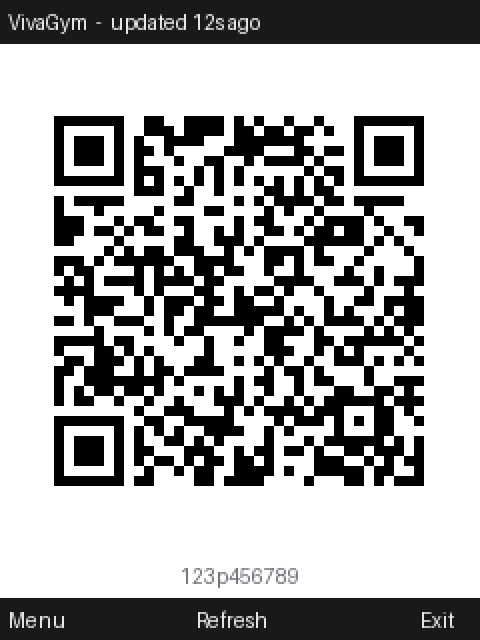
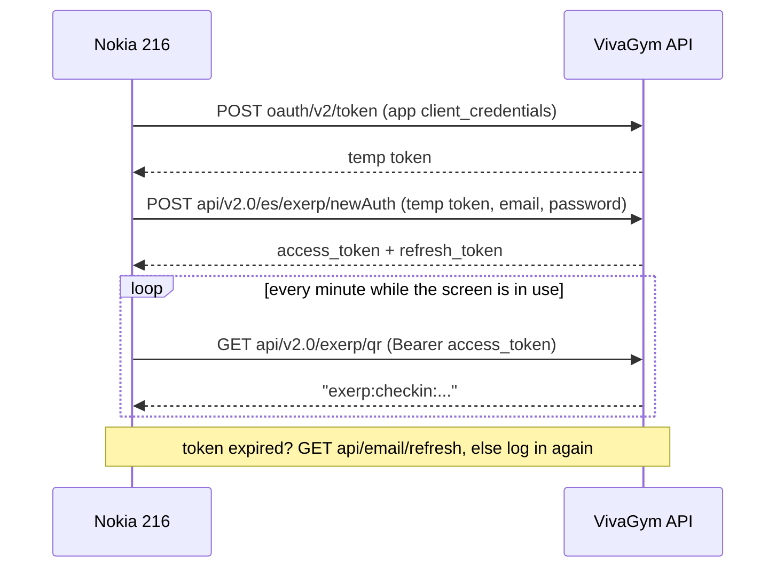

# A new life for my Nokia 216

I wanted to leave my smartphone at home. The plan was simple: carry a Nokia 216, a
2016 feature phone that lasts days on a charge, and only grab the smartphone when I really
need it. The problem is that modern life assumes a smartphone. The one that annoyed me most
was my gym: VivaGym only lets you in by scanning a QR code from their Android app.

So this repo is the story of turning a cheap dumbphone into something I can actually live
with: running my own apps on it, building a toolchain for it, writing a web browser that
does real HTTPS on a 2G phone, and finally reverse-engineering my gym's app so the Nokia
can show my check-in QR at the turnstile. (Spoiler: it works.)

<p align="center">
  
  <br><sub>The VivaGym check-in app (mock-up, fake code, drawn by the app's own QR encoder)</sub>
</p>

---

## Contents

1. [Getting to know the phone](#1-getting-to-know-the-phone)
2. [Running homebrew: the IMSI lock](#2-running-homebrew-the-imsi-lock)
3. [A real toolchain on Windows](#3-a-real-toolchain-on-windows)
4. [First apps: Snake, Telnet, games](#4-first-apps-snake-telnet-games)
5. [Nokia Web: HTTPS on a 2G phone](#5-nokia-web-https-on-a-2g-phone)
6. [Brainrot Launcher](#6-brainrot-launcher)
7. [VivaGym: my gym QR without a smartphone](#7-vivagym-my-gym-qr-without-a-smartphone)
8. [What I learned](#8-what-i-learned)
9. [Repo layout and how to build](#9-repo-layout-and-how-to-build)

---

## 1. Getting to know the phone

| | |
|---|---|
| Model | Nokia 216 (RM-1187) |
| OS | Series 30+ (firmware SUEZ.12.00.11) |
| SoC | MediaTek MT6260, ARM9 (ARMv5TE) |
| Network | 2G only (GPRS/EDGE) |
| Screen | 240×320, 16-bit colour |
| USB | mass storage: the memory card shows up as `D:` |

My first wrong assumption: I thought it ran Java ME or KaiOS. It runs neither. Series 30+
apps are **MediaTek MRE** (MAUI Runtime Environment) programs: native ARM code packed into
`.vxp` files and launched from the file manager. Even the built-in Opera Mini 4 is an MRE app.
That one fact decided everything else: my apps had to be C, compiled for ARMv5, talking to
the MRE API (`vm_graphic_*`, `vm_tcp_*`, `vm_file_*`...).

## 2. Running homebrew: the IMSI lock

S30+ refuses to launch a `.vxp` unless it is **signed with the IMSI of the SIM that is in
the phone**. The "signature" is just a tag table at the end of the file:

- tag `0x12` must contain `"9" + IMSI` (ASCII),
- tag `0x02` (app id) is set to `0xFFFFFFFF`.

Online tools like vxpatch do this, but I didn't want to upload my IMSI anywhere, so I wrote
[`tools/vxpsign.py`](tools/vxpsign.py), an offline version:

```
python tools/vxpsign.py info app.vxp                       # dump the tag table
python tools/vxpsign.py sign app.vxp <IMSI> signed/app.vxp
```

Getting the IMSI was its own little puzzle. The Nokia doesn't show it, so I put the SIM in an
Android phone and read it over adb. `service call iphonesubinfo N` returns a raw Binder
Parcel, and the method number for "get subscriber id" changes between Android versions, so
[`tools/get_imsi.py`](tools/get_imsi.py) tries a range of them and decodes whatever looks
like a 15-digit number starting with the country code.

Then: copy the signed `.vxp` to `D:\Apps\`, open it from *File manager → Memory card → Apps*.
If you swap SIM cards, you have to re-sign everything.

## 3. A real toolchain on Windows

The official MRE SDK is old, Windows-only and proprietary. Instead I used
[gtrxAC's mre-makefile](https://github.com/gtrxAC/mre-makefile): plain `arm-none-eabi-gcc`,
`make`, `objcopy` and a Python script that adds the resources and tags. I set it up with
Arm GNU Toolchain 14.3 and w64devkit (for `make`/`objcopy`).

It didn't build out of the box with GCC 14. Two fixes, in [`patches/`](patches/):

- newlib now declares `_write` as returning `int`, and GCC 14 turned the old `void _write`
  stub into a hard error;
- the Makefile only linked `.c` objects, so any app with C++ files failed to link.

All the apps here share one copy of the SDK in [`sdk/`](sdk/).

## 4. First apps: Snake, Telnet, games

- **[Snake](apps/snake/)**: written from scratch to learn the MRE basics: a layer to draw on,
  a timer for the game loop, a keyboard callback. Classic green-LCD look.
- **TelnetVXP**: I ported [XimikBoda's TelnetVXP](https://github.com/XimikBoda/TelnetVXP)
  from the old SDK project files to the GCC Makefile. That upstream repo has no license, so
  my port isn't in this repo.
- **Games**: a Game Boy emulator (peanut) with the free homebrew *Tobu Tobu Girl*, and
  [mtmine64](https://github.com/gtrxAC/mtmine64) with my one-line GCC 14 fix.

The first networking lesson came from the Telnet port: every MRE example connects with
`VM_TCP_APN_CMNET`, which is a **China Mobile** preset. On my Nokia with a Spanish SIM it
picked the wrong data profile and DNS always failed. The fix is to ask the phone for its
default internet profile (`vm_get_default_apn_info` + `vm_dtacct_set`) and use that.

## 5. Nokia Web: HTTPS on a 2G phone

The built-in Opera Mini depends on Opera's proxy servers. I wanted a browser that talks to
websites itself, which today means **TLS**. [Nokia Web](apps/nokia-web/) is a text browser:

- **TLS 1.2 on the phone** with [BearSSL](https://bearssl.org/), small enough for an ARM9,
  with 26 root certificates from the Mozilla list compiled in.
- **Coroutines** (libco) so the networking code can be written as a normal loop
  (connect, write, read...) even though MRE is callback-driven: the network coroutine
  yields back to the UI timer every time it would block.
- **Randomness** for TLS is a real problem on a device with no RNG API: I mix timer ticks,
  key presses, the IMEI and the clock into SHA-256, and save a seed file between runs.
- **The clock** matters for certificate validity. If the phone's date was never set, I fall
  back to a fixed recent date instead of rejecting every certificate.
- An HTML-to-text engine with links, headings, entities, UTF-8/Latin-1, redirects and chunked
  bodies, all in fixed buffers (no `malloc` in the hot path).

Limits: no CSS, JS, images or forms, and sites that only accept TLS 1.3 fail. Most "lite"
sites (DuckDuckGo Lite, Wikipedia mobile, text.npr.org, lite.cnn.com) work well.

I test it on the PC: `tools/host_test.c` compiles the same `web.c` for Windows with the MRE
calls stubbed (Winsock instead of `vm_tcp_*`), so I can debug parsing and TLS against live
sites without copying files to the phone every time.

## 6. Brainrot Launcher

Opening apps through the file manager gets old fast. [Brainrot Launcher](apps/brainrot-launcher/)
lists `Apps\*.vxp` and shows them as a grid where every app gets a pixel-art character.
The sprites are generated by a Python script (`tools/brainrot_art.py`) and compiled into the app.

<p align="center"></p>

## 7. VivaGym: my gym QR without a smartphone

This was the reason for everything.

### Reverse-engineering the Android app

I downloaded the VivaGym app (XAPK), unpacked it and decompiled the DEX files with
**jadx**. I expected to find the QR being generated on the phone, maybe with a secret key
to sign it. That would have meant porting crypto to the Nokia. Instead, the endpoint list
(`Api.java`, a Retrofit interface) had this:

```java
@GET("api/v2.0/exerp/qr")
Call<String> getQR();
```

**The server generates the whole QR string.** The app only logs in, asks for the string
and draws it. The string looks like this:

```
exerp:checkin:<member id>-<timestamp ms>-<32 hex digest>
```

Exerp is the gym-management platform behind VivaGym; the timestamp and digest change over
time, so the code has to be re-fetched now and then. No device secret, no crypto: the whole
"engine" is *log in → GET a string → draw a QR*.

Login turned out to be two steps (my first attempt returned HTTP 400 until I understood this):



I first wrote the whole flow as a Python proof of concept
([`apps/vivagym/research/`](apps/vivagym/research/)), together with my notes
([`FINDINGS.md`](apps/vivagym/research/FINDINGS.md)).

### The Nokia app

[`apps/vivagym`](apps/vivagym/) reuses Nokia Web's TLS and networking code. What's new:

- **A QR encoder in C** (`qr.c`): byte mode, error correction M, versions 1–10, automatic
  mask selection, no dynamic memory. My check-in string fits a version-5 code (37×37), which
  is 5 px per module on the 240 px screen with a proper quiet zone. I checked it against the
  Python `qrcode` library: 112 test matrices across all versions and all 8 masks are
  bit-identical.
- **Session handling**: the access and refresh tokens are cached on the phone; when the API
  says 401, the app tries the refresh token, then a full login.
- **Gym-friendly behaviour**: it refreshes the code every minute and keeps the backlight on
  (`vm_switch_power_saving_mode`), but only for 5 minutes after the last key press, so it
  doesn't burn battery and data in my pocket. If an update fails, the last code stays on screen.
- **Testing without my account**: `tools/mock_server.py` is a fake VivaGym API and
  `tools/host_vg.c` runs the app's real logic on the PC against it: fresh login, expired
  token → refresh, bad refresh → password login, wrong password, chunked responses, and
  saving/loading the settings file.

**And it works.** I tested it on the real phone with my real membership: the Nokia logs in,
shows my check-in QR, and the gym's scanner accepts it.

What's not in this repo: my email, password, member id and real QR codes, and the app's
OAuth client id/secret. Those live in `src/secrets.h`, which is gitignored. If you have a
VivaGym membership, copy `secrets.example.h` and fill in the client values from your own
decompiled copy of the app.

> This is for showing **my own** check-in code with **my own** membership, exactly what the
> official app does. It doesn't forge codes or get around anything. Not affiliated with
> VivaGym, MyVitale or Exerp.

## 8. What I learned

- **Check your assumptions about the platform first.** I almost started a Java ME app.
  Knowing the phone runs MRE (native ARM, `.vxp`) changed the whole plan.
- **Old SDKs + new compilers**: most breakage is small (a return type, a missing link rule),
  but you only find it by reading the errors instead of downgrading everything.
- **Networking on feature phones** is mostly about the operator profile: "DNS failed" was
  really "wrong APN".
- **TLS on tiny hardware is possible.** BearSSL fits, but you have to provide the things a
  PC gives for free: entropy, a sane clock, trusted roots and enough stack.
- **Coroutines make callback APIs bearable.** Writing a TLS client as a chain of callbacks
  would have been a nightmare; one coroutine that yields made it look like normal code.
- **Reverse engineering is mostly reading.** jadx + following one call (`getQR()`) answered
  the big question in minutes: the server does the work, not the app.
- **Test on the PC whatever doesn't need the phone.** Host builds with stubbed MRE calls,
  a mock server and comparing my QR output against a reference library caught bugs before
  anything touched the phone.
- **Keep personal data out of the code**: credentials in a gitignored header, an offline
  signing tool instead of uploading my IMSI, and placeholders in the published notes.

## 9. Repo layout and how to build

```
apps/
  nokia-web/            text browser with on-device HTTPS
  snake/                Snake
  brainrot-launcher/    app grid launcher
  vivagym/              gym check-in QR (+ research/: notes and Python PoC)
sdk/                    shared MRE headers, libs and packaging script (mre-makefile)
tools/
  vxpsign.py            sign a .vxp with your SIM's IMSI (offline)
  get_imsi.py           read the IMSI from an Android phone over adb
patches/                GCC 14 fixes for upstream mre-makefile and mtmine64
docs/                   images for this README
```

**You need:** [Arm GNU Toolchain](https://developer.arm.com/downloads/-/arm-gnu-toolchain-downloads)
(`arm-none-eabi-gcc`, I used 14.3), `make` + `objcopy` (on Windows,
[w64devkit](https://github.com/skeeto/w64devkit)) and Python 3.

```
cd apps/snake
make APP_FILE_NAME=Snake PYTHON=python
python ../../tools/vxpsign.py sign Snake.vxp <IMSI> Snake_signed.vxp
copy Snake_signed.vxp D:\Apps\Snake.vxp
```

Same for the other apps. For VivaGym, first `copy src\secrets.example.h src\secrets.h` and
fill it in (leave email/password empty and the phone asks for them on first start).

Each app's keys are in its source header comment. Third-party code and licenses: [CREDITS.md](CREDITS.md).
My code is MIT ([LICENSE](LICENSE)).
